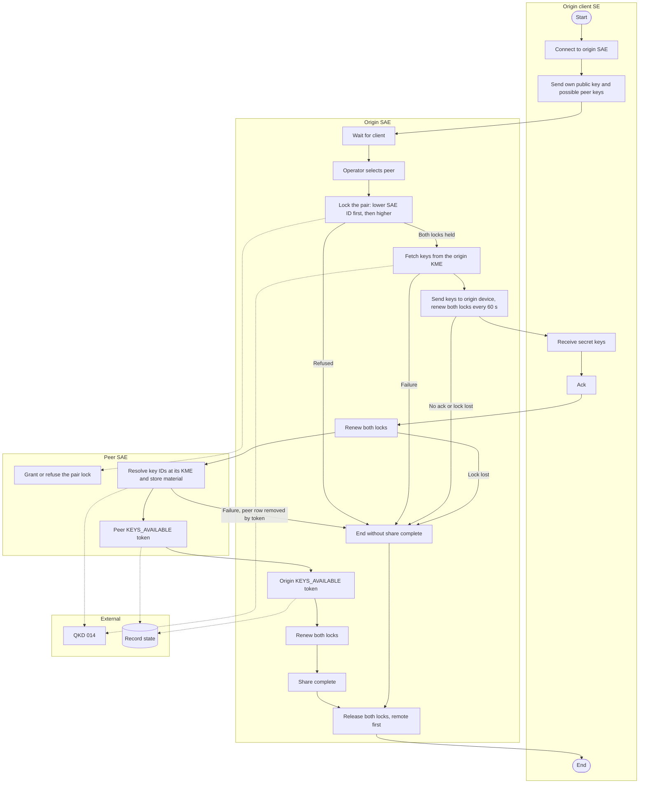
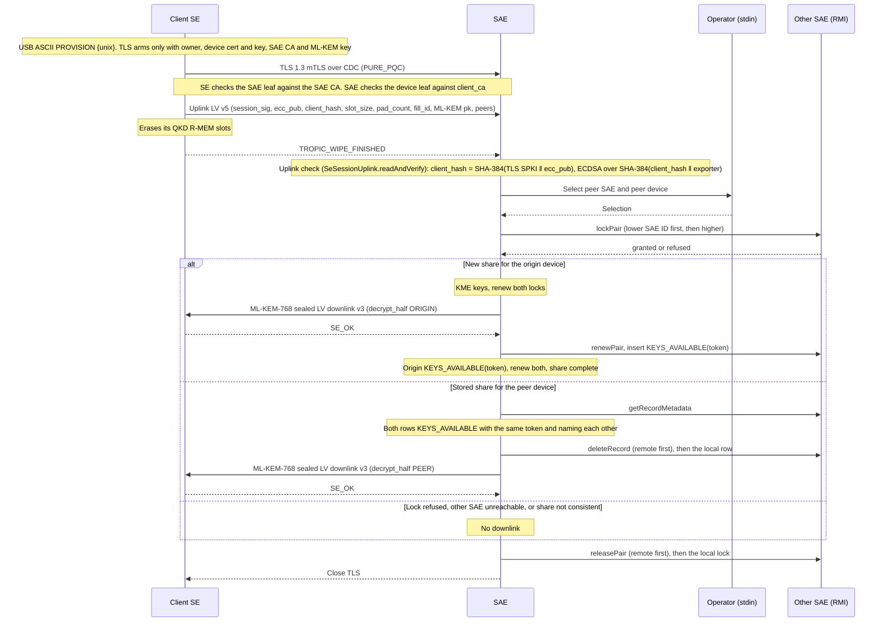
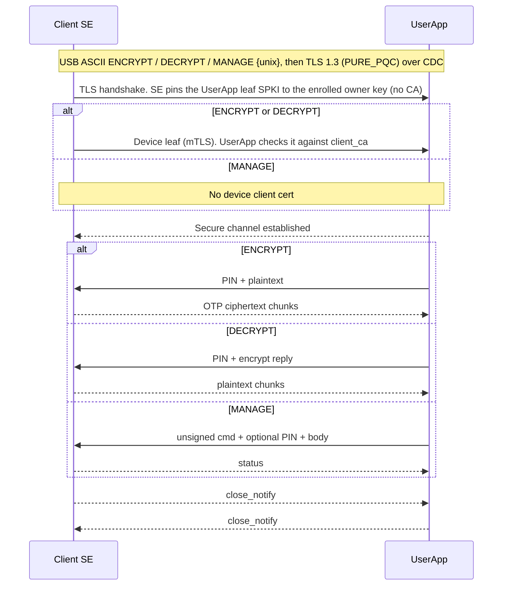
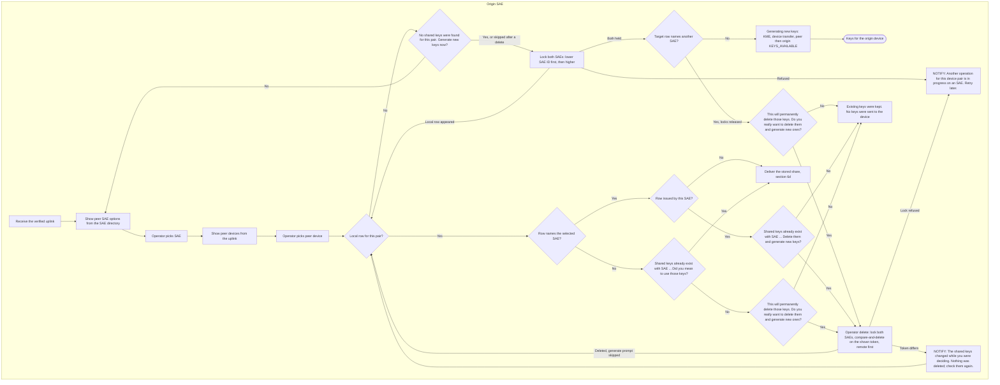
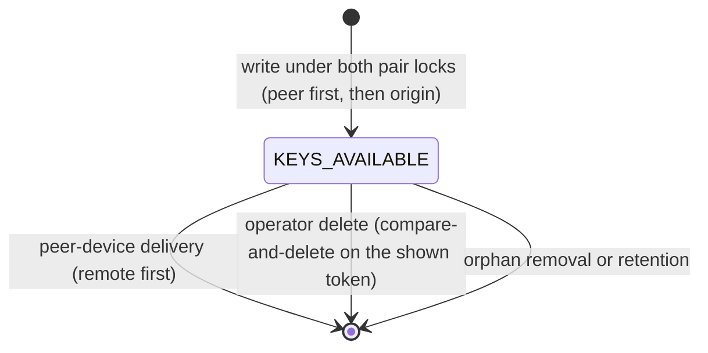
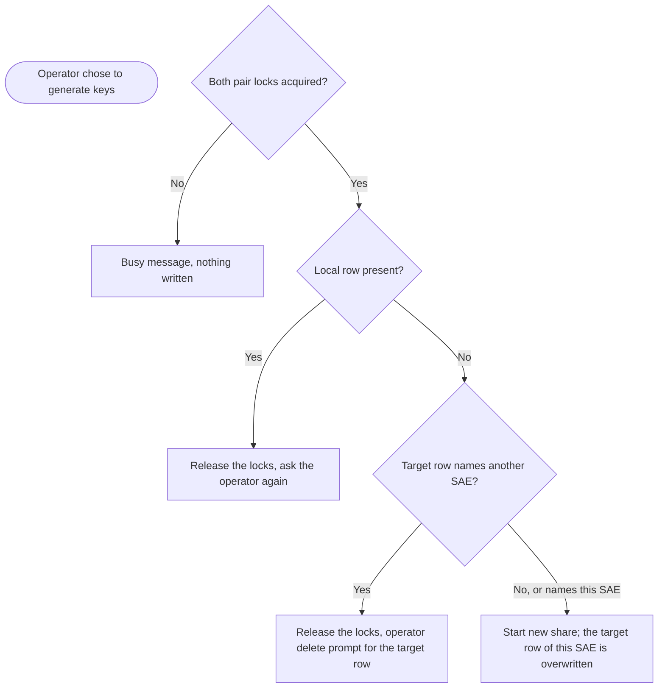
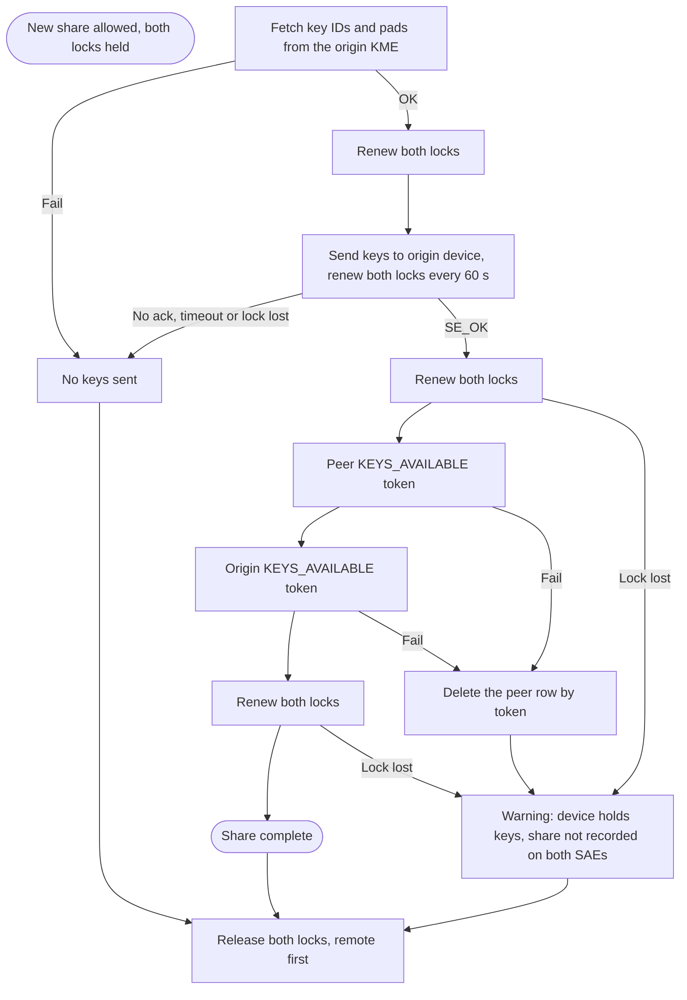
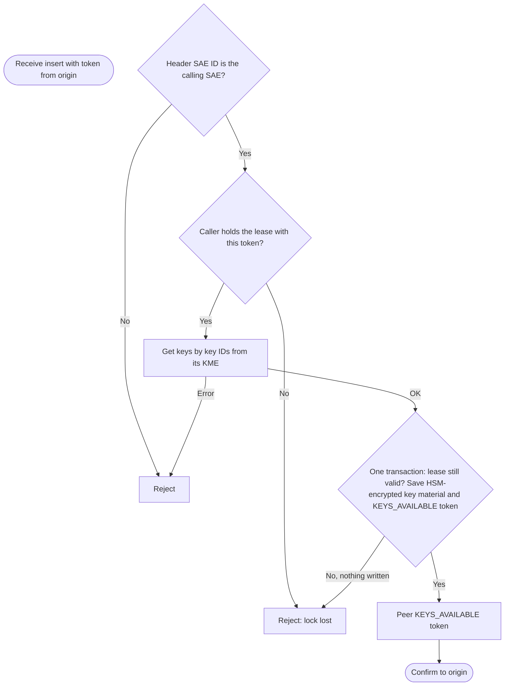
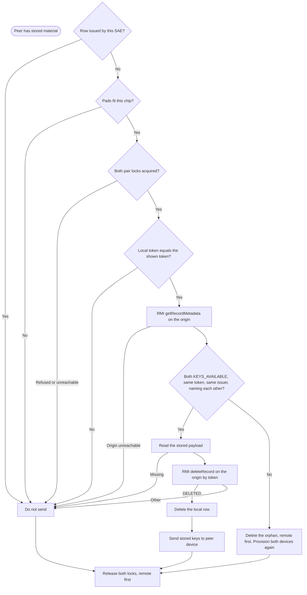

# SAE / USER / SE Flowcharts

High-level flowcharts. **SAE** (SaeNode) is provision / QKD fill.
**USER** (UserApp) is encrypt / decrypt / manage. UserApp is not an SAE. These
show the intended design, not method-level control flow.

---

## 1. Main end-to-end provision flow (device ↔ SAE)

Origin device gets a new share. The origin SAE locks the pair on both SAEs
(lower SAE ID first), fetches the keys from its KME and transfers them to the
device while it renews both locks every 60 s. After the device ack it renews
both locks, the peer SAE writes `KEYS_AVAILABLE(token)`, then the origin SAE
writes `KEYS_AVAILABLE(token)`, and it renews both locks again. Only then does
the terminal "share complete" line appear (`Loading 100% … Share successful.`).
The locks are released, remote first. A later peer device is section 6d.

---

## 2. SE ↔ SAE communication (`PROVISION` only)

Device TLS client to SaeNode over USB CDC.
This is **not** encrypt / decrypt — those sessions are device ↔ USER.
The full decision tree is [`diagrams/provision_flow.drawio`](../../diagrams/provision_flow.drawio).

---

## 3. SE ↔ USER communication (`ENCRYPT` / `DECRYPT` / `MANAGE`)

Device TLS client to **UserApp**. UserApp is not an SAE. PIN and OTP payloads
never go to SaeNode.

---

## 4. Operator stdin on SaeNode

Operator SELECT / CONFIRM / NOTIFY runs in the SaeNode process (stdin), **not**
UserApp and not a separate TLS gateway. The SAE builds selection lists from the
SAE directory and the client payload, then prompts on the same console. The
prompts follow `ProvisionSession.process`: a pair without a local row asks
"Generate new keys now?", except right after a delete.

---

## 5. Record states and pair locks

Each SAE keeps one `client_record_state` row per client pair. The key material
is in `shared_key_material`. A row has a single state,
`KEYS_AVAILABLE` (`AtomicRecordStateMap.RecordAvailability`), and carries the
`lease_token` of the operation that wrote it and its `issuing_sae_id`.

| State | Set by | Meaning |
| --- | --- | --- |
| `KEYS_AVAILABLE` | peer: `insert(record, token)` over RMI, key IDs resolved at its KME and written in one transaction under the caller's lease; then origin: `writeOrigin` under its own lease, both after the device `SE_OK` | The SAE holds its half of the share written by the operation with that token. A share is usable only when both rows are `KEYS_AVAILABLE`, carry the same token and name each other |

**Pair locks.** Every operation on a client pair (new share, peer-device
delivery, operator delete) holds a lock on both SAEs of the pair
(`PairLocks`, `PairLockRegistry`). The lock is keyed by the sorted pair of
client hashes and held in memory. The operation takes the lock of the SAE with
the lower ID first, then the higher one, over RMI `lockPair` for a remote SAE.
A refusal releases the first lock and ends the operation with the busy
message; nobody waits for a lock. A lock is a lease of 5 minutes with a random
128-bit token and the issuing SAE; the holder renews both leases every 60 s
(`renewPair`) and before and after each commit step (`PairOperation.checkpoint`).
A failed renewal aborts the operation and closes the device session. Every row
write and delete runs in one `BEGIN IMMEDIATE` transaction that checks the
token, expiry and issuer of the lease. The operation releases both locks by
token, remote first (`releasePair`).

Retention: `RecordRetention` runs at node start and then every 24 hours. It
deletes `client_record_state` rows older than `RECORD_RETENTION_DAYS`
(default 14), each only while nobody holds the pair lock, and their
`shared_key_material` rows go with them (`ON DELETE CASCADE`). Reads treat such
rows as absent.

---

## 6. SAE database persistence decisions

Origin publishes the **reversed** hash pair to the peer SAE (`(peerHash, myHash)`);
each node looks up only the pair it stored.

### 6a. Can a new share start?

`ProvisionSession.newShare` under both pair locks. "Target" is the other SAE
named in the request.

### 6b. Origin device: new share

### 6c. Peer SAE during the exchange

### 6d. Later: peer device

A second device is filled from the **stored** peer material only when both
rows are `KEYS_AVAILABLE` with the same token and name each other, checked
under both pair locks at use time. Deletes are remote-first: the origin row is
removed over RMI before the local row.

---

## 7. Component overview

The deployment design and its install steps (the user PC, where the user
application enrolls the keychain, and one SAE; the second SAE is the same
design) are drawn in
[`diagrams/deployment.drawio`](../../diagrams/deployment.drawio). Trust anchors,
truststores and pins are in [`diagrams/trust_pki.drawio`](../../diagrams/trust_pki.drawio);
the RMI startup checks and one pinned call are in
[`diagrams/rmi_pinning.drawio`](../../diagrams/rmi_pinning.drawio).
