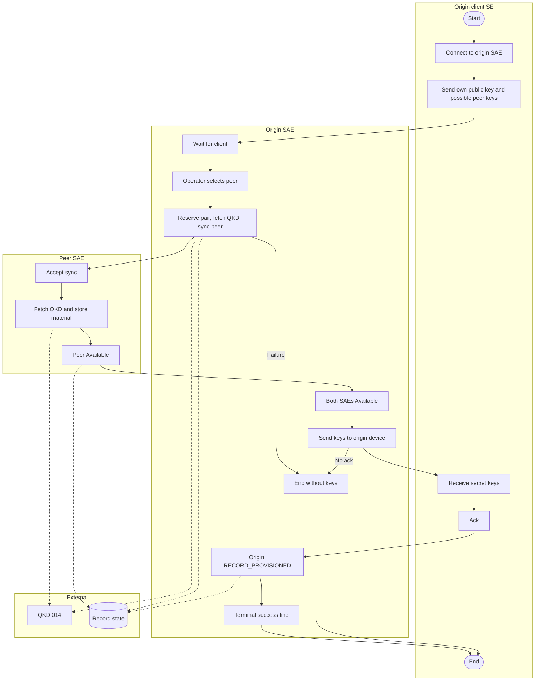
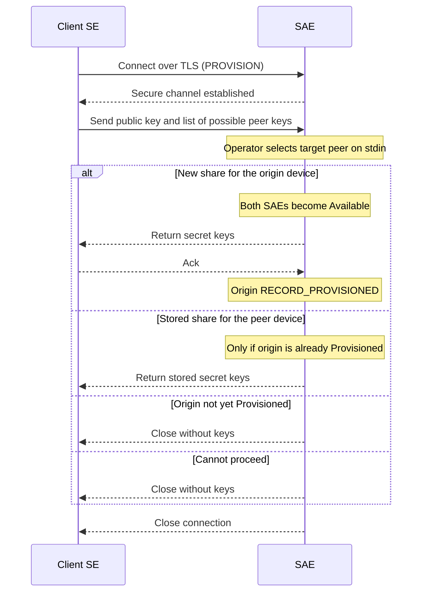
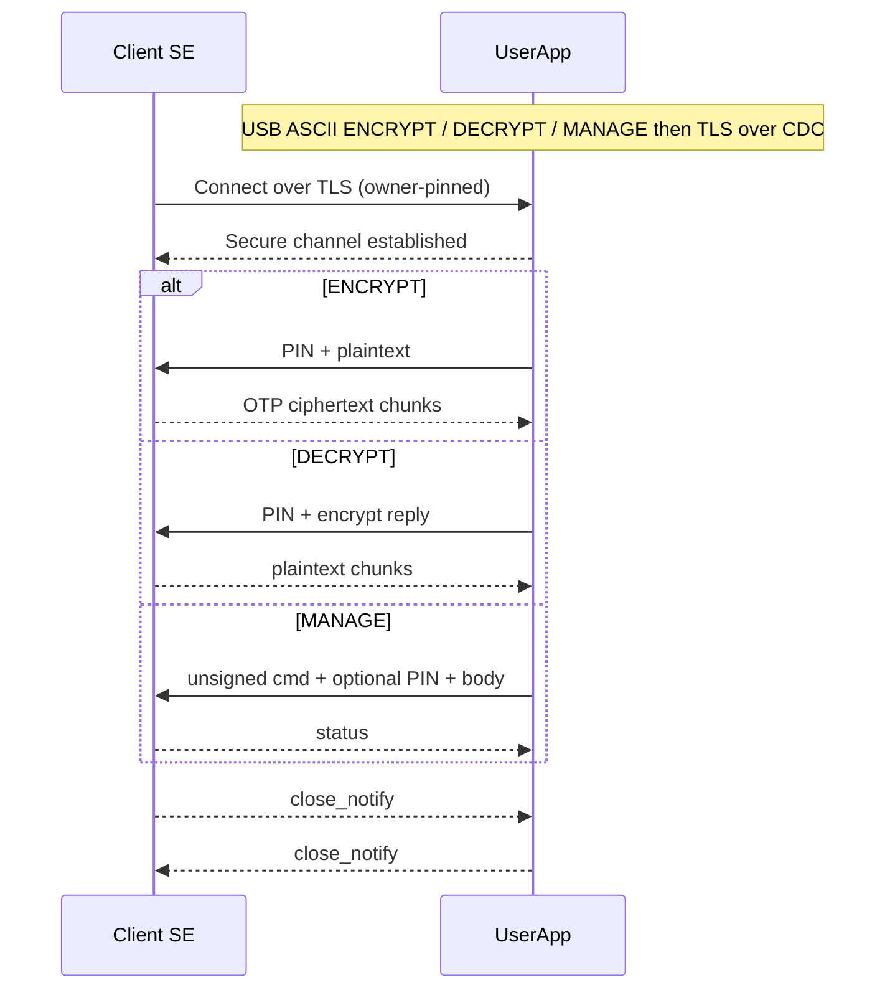
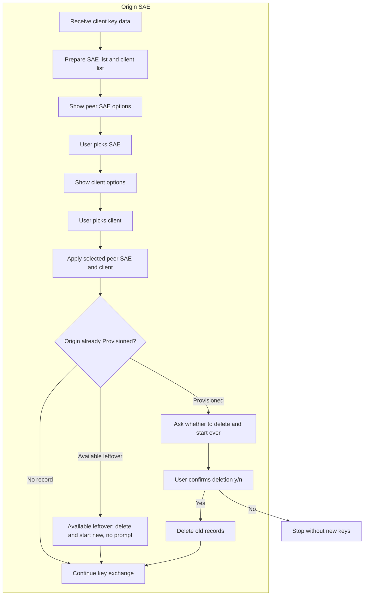
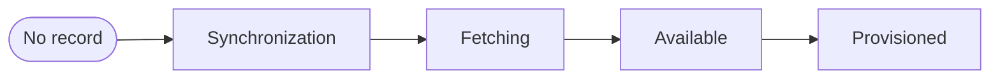
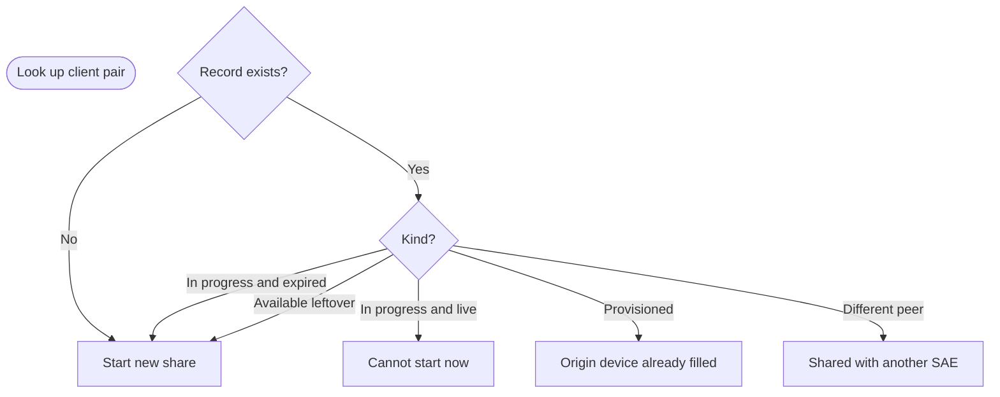
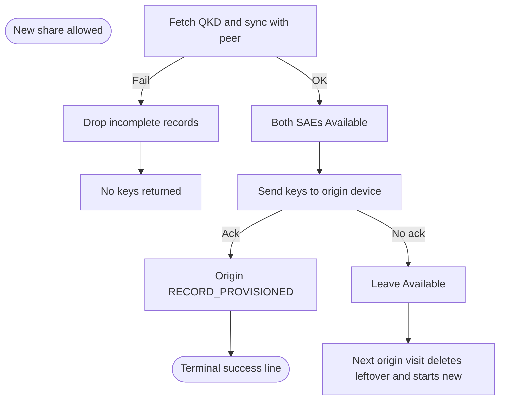
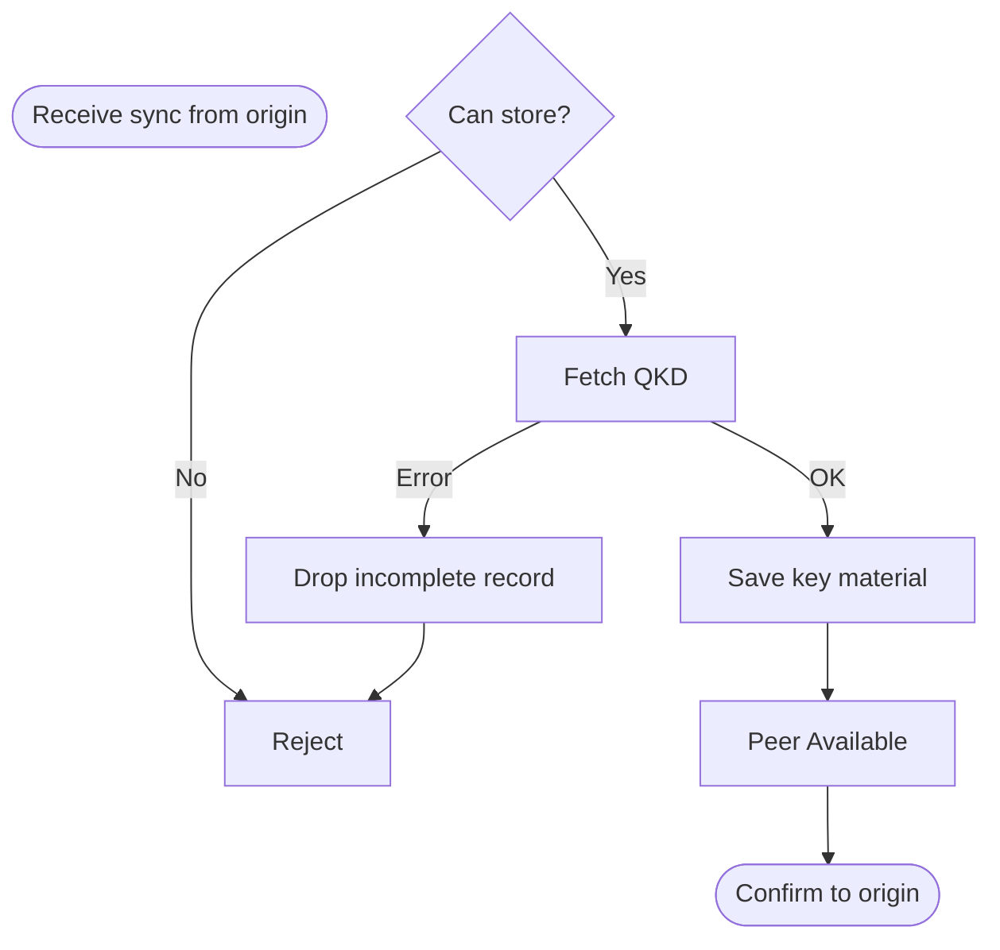
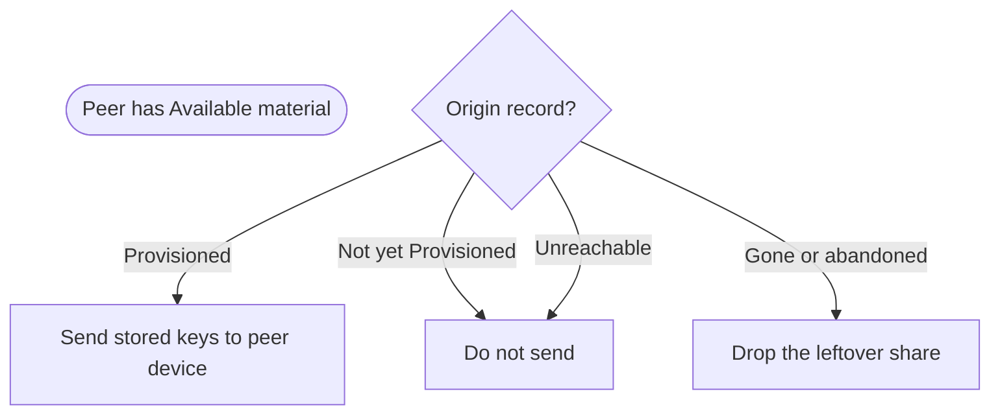
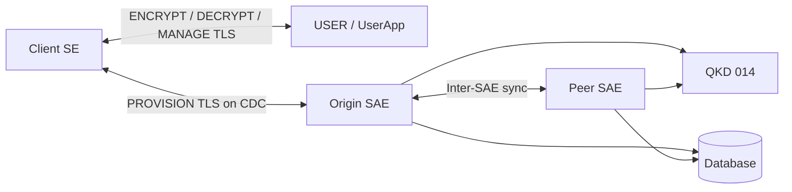

# SAE / USER / SE Flowcharts

High-level flowcharts. **SAE** (SaeNode) is provision / QKD fill.
**USER** (UserApp) is encrypt / decrypt / manage. UserApp is not an SAE. These
show the intended design, not method-level control flow.

---

## 1. Main end-to-end provision flow (device ↔ SAE)

Origin device gets a new share. Both SAEs become **Available**, then the origin
device is filled; **RECORD_PROVISIONED** is only after that ack. The terminal
success line is printed only after that mark returns. A later peer
device is section 6d — not this chart.

---

## 2. SE ↔ SAE communication (`PROVISION` only)

Device TLS client to SaeNode over USB CDC.
This is **not** encrypt / decrypt — those sessions are device ↔ USER.

---

## 3. SE ↔ USER communication (`ENCRYPT` / `DECRYPT` / `MANAGE`)

Device TLS client to **UserApp**. UserApp is not an SAE. PIN and OTP payloads
never go to SaeNode.

---

## 4. Operator stdin on SaeNode

Operator SELECT / CONFIRM / NOTIFY runs in the SaeNode process (stdin), **not**
UserApp and not a separate TLS gateway. The SAE builds selection lists from the
client payload and its configured peer SAEs, then prompts on the same console.

---

## 5. Record states

Each SAE keeps **record state** for a client pair (not the key bytes). Key
material lives on the **peer**. **Provisioned** is origin-only: the origin
device has acknowledged the downlink.

| State | Meaning |
| --- | --- |
| Synchronization | Pair reserved; exchange not locked yet |
| Fetching | Both sides locked; QKD fill in progress |
| Available | Share committed but origin fill did not finish. Leftover; not success |
| Provisioned | Origin device acked. Peer device may now take the stored half |

The peer row stops at **Available**. It never becomes **Provisioned**.

---

## 6. SAE database persistence decisions

Origin publishes the **reversed** hash pair to the peer SAE (`(peerHash, myHash)`);
each node looks up only the pair it stored.

### 6a. Can a new share start?

### 6b. Origin device: new share

### 6c. Peer SAE during the exchange

### 6d. Later: peer device

A second device is filled from the **stored** peer material only after the
origin device is **Provisioned**. Available on both SAEs is not enough.

---

## Component overview

